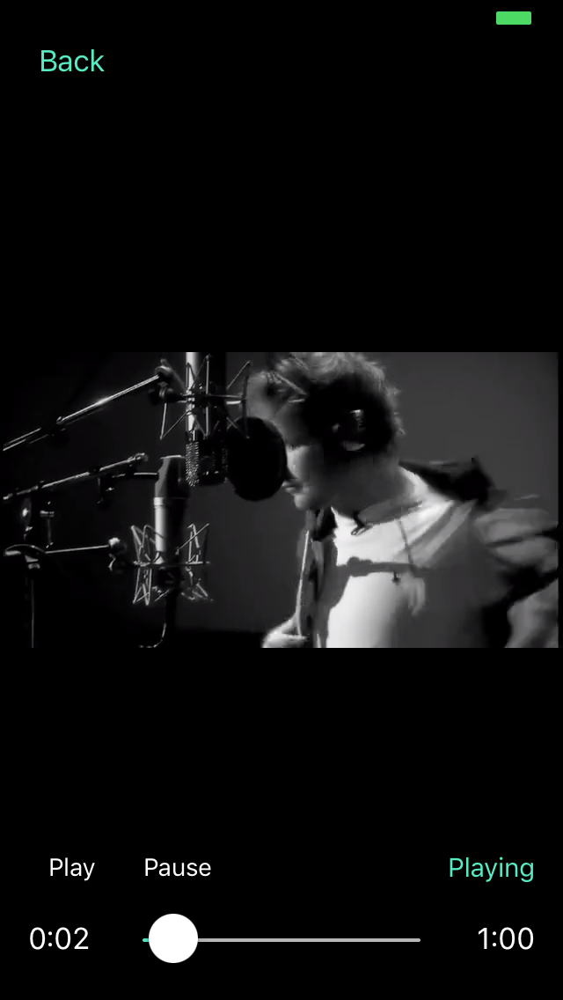
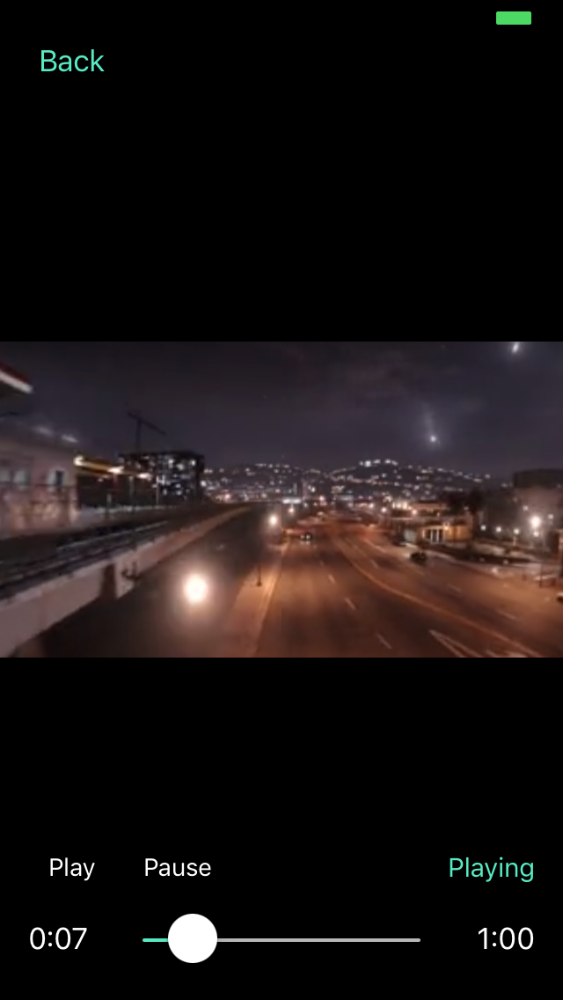
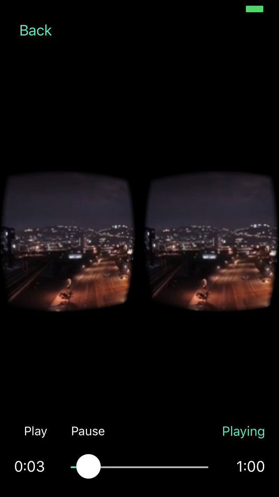
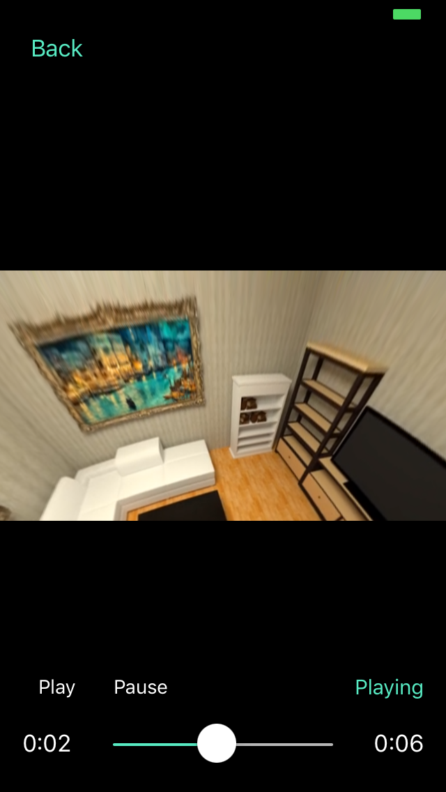
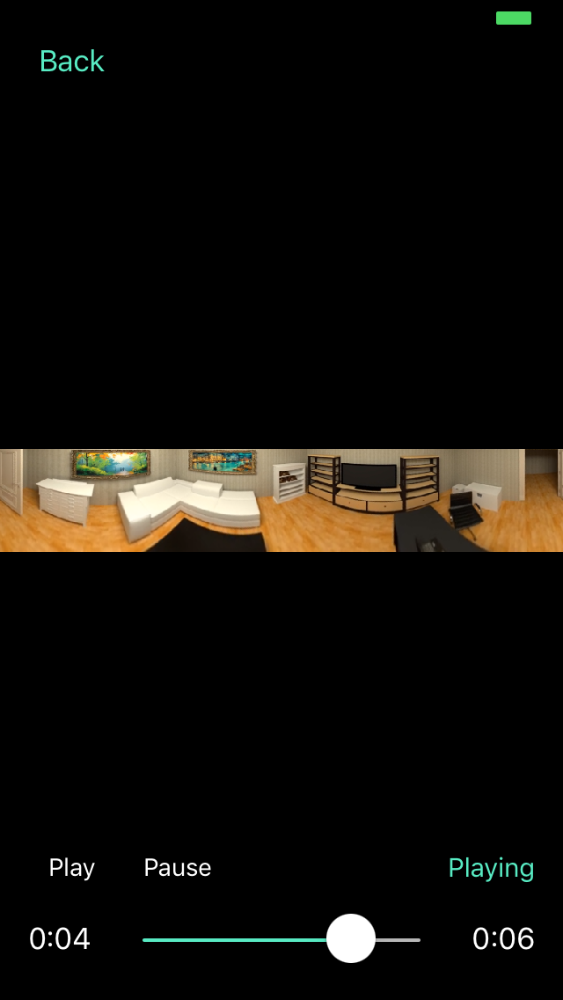
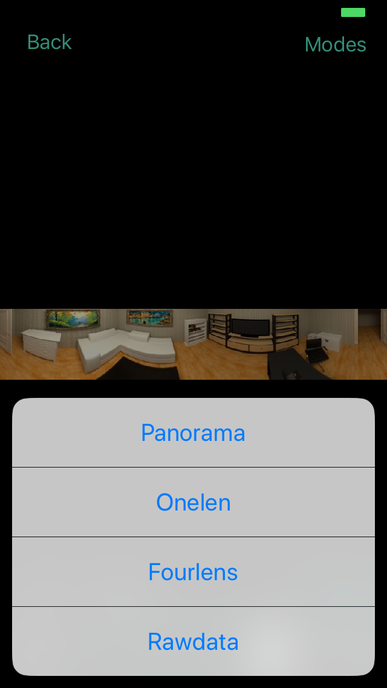
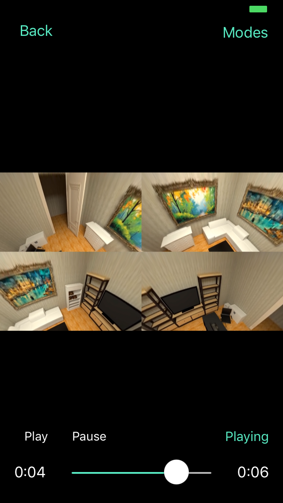
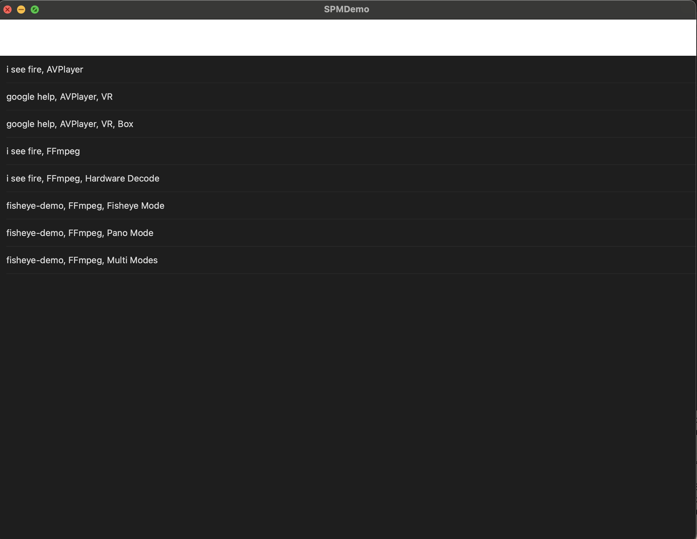
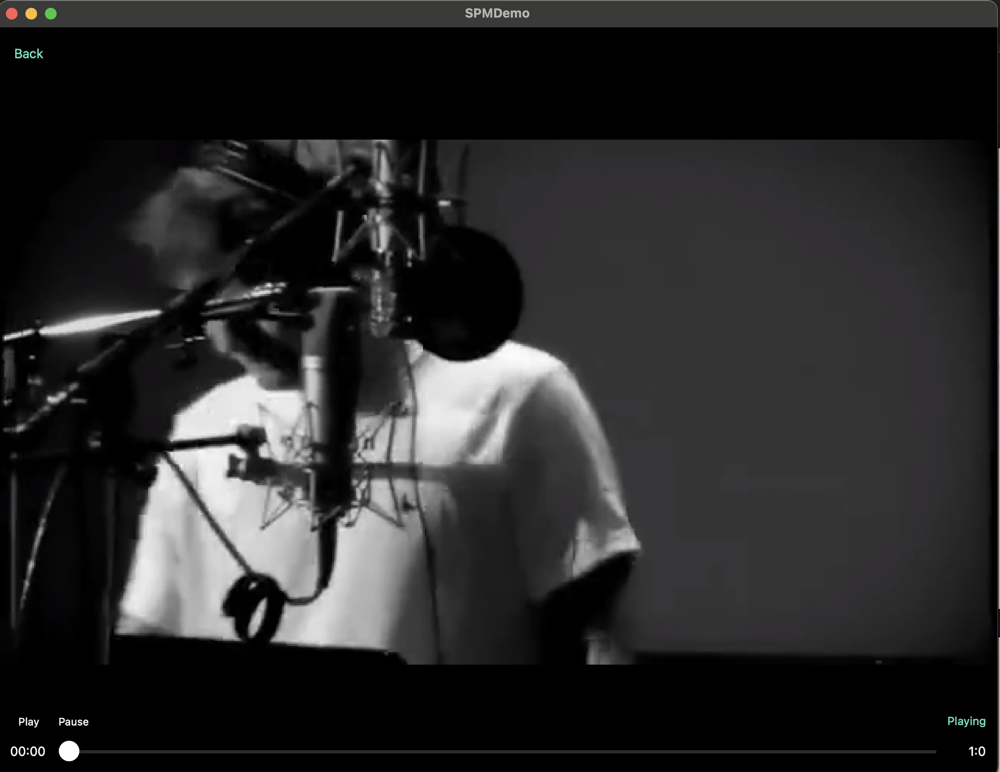

[](https://github.com/irons163/IRPlayer-swift/actions/workflows/ci.yml)


# IRPlayer-swift

### IRPlayer-swift is a powerful video player framework for iOS.

- Use IRPlayer to play video.
    - See demo.
- Use IRPlayer to make video player with custom UI.
    - See [IRPlayerUIShell](https://github.com/irons163/IRPlayerUIShell)
- Use IRPlayer to play IP Camera stream.
    - See [IRIPCamera](https://github.com/irons163/IRIPCamera)
- Use IRPlayer to make Screen Recoder.
    - See [IRRecoder](https://github.com/irons163/IRRecoder)
- Use IRPlayer to make RTMP streaming.
    - See [IRLiveKit](https://github.com/irons163/IRLiveKit)
- Use IRPlayer to make video player with effects .
    - See [IREffectPlayer](https://github.com/irons163/IREffectPlayer)
- Real Live player App.
    - See [IRLive](https://github.com/irons163/IRLive)

## Features

- Support Normal video mode.
- Support VR mode.
- Support VR Box mode.
- Support Fisheye mode.
    - Support Normal Fisheye mode.
    - Support Fisheye to Panorama mode.
    - Support Fisheye to Perspective mode.
- Support multi windows.
- Support multi modes selection.
- Support set the specific renders to each mode.
- Support custom video input(IRFFVideoInput). See what it works in [IRIPCamera](https://github.com/irons163/IRIPCamera).
- Support custom display view(inherit IRGLView). See what it works in [IREffectPlayer](https://github.com/irons163/IREffectPlayer).
- Support SPM.

## Install
### SPM
- Add package: https://github.com/irons163/IRPlayer-swift

## CI and releases

Run the complete release acceptance suite with
`Scripts/ci/run-acceptance.sh all`. See the
[release process](docs/releases/release-process.md) for the enforced GitHub
Actions gates and automated tag-to-Release flow.

## Usage

`IRPlayer` is the preferred Swift API in 2.0. A media load is described by one
`IRMediaSource`, and player-wide behavior is described by
`IRPlayerConfiguration`.

```swift
import UIKit
import IRPlayerSwift

final class ViewController: UIViewController {
    private let player = IRPlayer(configuration: IRPlayerConfiguration(
        autoplay: true,
        playableBufferInterval: 2,
        volume: 1
    ))
    private var playerObservation: IRPlayerObservation?

    override func viewDidLoad() {
        super.viewDidLoad()

        if let playerView = player.view {
            view.addSubview(playerView)
            playerView.frame = view.bounds
        }

        playerObservation = player.observeEvents { event in
            switch event {
            case .stateChanged(_, let current):
                print("state:", current)
            case .progress(let time):
                print("progress:", time.current, "/", time.total)
            case .playable(let time):
                print("playable:", time.current)
            case .failure(let error):
                print("playback failed:", error.error)
            }
        }

        player.load(IRMediaSource(
            url: URL(string: "https://commondatastorage.googleapis.com/gtv-videos-bucket/sample/BigBuckBunny.mp4")
        ))
    }
}
```

The returned `IRPlayerObservation` owns the subscription. Retain it for as long
as events are needed; call `cancel()` to stop observing. Events are delivered on
the main thread.

### Backend selection

Automatic selection uses AVFoundation for common MP4/HLS media and FFmpeg for
formats such as RTSP/RTMP/FLV. A load can override that decision without
mutating global decoder settings:

```swift
player.load(IRMediaSource(
    url: streamURL,
    headers: ["Authorization": "Bearer token"],
    videoType: .vr,
    backendPreference: .ffmpeg
))
```

### Presentation modes

```swift
player.displayMode = .box
player.load(IRMediaSource(url: vrURL, videoType: .vr))

player.load(IRMediaSource(
    url: fisheyeURL,
    videoType: .fisheye,
    backendPreference: .ffmpeg
))
```

For caller-defined render modes, assign `renderModes` and load the source with
`videoType: .custom`.

### Custom video input

A custom FFmpeg input is part of the media source. The URL is still required as
the session identity and format source.

```swift
let input = IRFFVideoInput()
player.load(IRMediaSource(
    url: sourceURL,
    videoType: .normal,
    videoInput: input,
    backendPreference: .ffmpeg
))

let yuvFrame = IRFFAVYUVVideoFrame()
// Configure the frame planes, dimensions, position, and duration.
let admitted = input.trySend(videoFrame: yuvFrame)
// A false result means IRPlayer already rejected and reclaimed the frame.
```

Custom RGB frames declare their byte layout explicitly and are validated as
one immutable generation:

```swift
if let frame = IRVideoFrameRGB(
    width: width,
    height: height,
    pixelFormat: .bgra32,
    bytesPerRow: bytesPerRow,
    data: bytes
) {
    _ = input.trySend(videoFrame: frame)
}
```

For custom packet decoding, subclass `IRFFVideoInput` and override
the routing and typed decode callbacks. See
[IRIPCamera-swift](https://github.com/irons163/IRIPCamera-swift) for a complete
integration.

```swift
class MyIRFFVideoInput: IRFFVideoInput {

    override func shouldHandle(
        _ videoDecoder: IRFFVideoDecoderInfo,
        packet: IRFFVideoPacketDescriptor
    ) -> Bool {
        true
    }

    override func videoDecoder(
        _ videoDecoder: IRFFVideoDecoderInfo,
        decodeFrame packet: IRFFCompressedVideoPacket,
        completion: IRFFCustomVideoDecodeCompletion
    ) -> IRFFCustomVideoDecodeOutcome {
        Task { [completion] in
            // packet and codec own all bytes and are safe to retain here.
            let videoFrame = await decode(
                packet.data,
                codec: videoDecoder.codec
            )
            completion.send(videoFrame: videoFrame)
        }
        return .deferred
    }
}
```

Return `.frame(frame)` for synchronous output, `.dropped` for an intentional
no-output packet, or `.failed(error)` for a terminal custom-decode failure.
For `.deferred`, retain the supplied one-shot completion until calling
`send(videoFrame:)`, `drop()`, or `fail(_:)`. Releasing an unresolved completion
auto-drops its reservation; seek and stop invalidate it, and a late frame is
reclaimed. `videoDecoder.maximumDecodeDuration` controls built-in buffered
output backpressure; it is not a deferred-completion timeout.

### Migrating from 1.x

`IRPlayerImp`, `replaceVideoWithURL`, and selector-based notifications remain
available during the 2.x migration window. New code should use `IRPlayer`,
`load(_:)`, and `observeEvents(_:)`. See
[`docs/releases/2.0-migration.md`](docs/releases/2.0-migration.md) for mappings.

### Advanced settings
```swift
player.renderModes = createFisheyeModes(with: nil)
player.load(IRMediaSource(url: fisheyeURL, videoType: .custom))

func createFisheyeModes(with parameter: IRMediaParameter?) -> [IRGLRenderMode] {
    let normal = IRGLRenderMode2D()
    let fisheye2Pano = IRGLRenderMode2DFisheye2Pano()
    let fisheye = IRGLRenderMode3DFisheye()
    let fisheye4P = IRGLRenderModeMulti4P()
    let modes = [
        fisheye2Pano,
        fisheye,
        fisheye4P,
        normal
    ]

    normal.shiftController.enabled = false
    fisheye2Pano.contentMode = .scaleAspectFill
    fisheye2Pano.wideDegreeX = 360
    fisheye2Pano.wideDegreeY = 20
    fisheye4P.parameter = IRFisheyeParameter(width: 0, height: 0, up: false, rx: 0, ry: 0, cx: 0, cy: 0, latmax: 80)
    fisheye.parameter = fisheye4P.parameter
    fisheye4P.aspect = 16.0 / 9.0
    fisheye.aspect = fisheye4P.aspect

    normal.name = "Rawdata"
    fisheye2Pano.name = "Panorama"
    fisheye.name = "Onelen"
    fisheye4P.name = "Fourlens"

    return modes
}

```

## Screenshots
| Normal | VR | VR Box | Fisheye 360
|:---:|:---:|:---:|:---:|
|   |    |  |  |
| Panorama | Modes Selection | Multi Windows |
|  |  |  |

| Mac Player 1 | Mac Player 2 |
|:---:|:---:|
|  |  |


## Credit
##### This project has some basic codes from [SGPlayer](https://github.com/libobjc/SGPlayer).
##### FFMpeg xcframeworks are from [ffmpeg-kit](https://github.com/arthenica/ffmpeg-kit).
